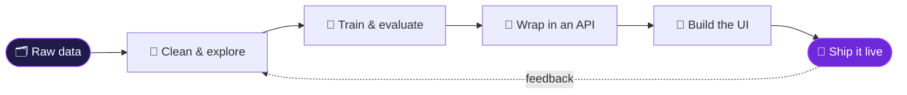

<a id="top"></a>

<div align="center">

<a href="https://github.com/ahmedmustafa28"></a>

<p>
  
  
  
</p>

<a href="#about"></a>
<a href="#now"></a>
<a href="#player"></a>
<a href="#stack"></a>
<a href="#stats"></a>
<a href="#connect"></a>

</div>


<a id="about"></a>


<details>
<summary><b>🎲 &nbsp;Mini-game: Two Truths &amp; a Lie — tap to play</b></summary>
<br/>

> **1.** I used to be a *Director of Visuals* before I wrote production code.<br/>
> **2.** I speak three languages: Sindhi, Urdu and English.<br/>
> **3.** I have never written a single line of JavaScript.

<details>
<summary>🤔 &nbsp;Made your guess? Tap to reveal</summary>
<br/>

**#3 is the lie!** JavaScript and TypeScript are in my daily toolkit (check the arsenal below). The other two are 100% true. 🎯

</details>
</details>

<details>
<summary><b>🐍 &nbsp;Bonus: me, written in Python</b></summary>
<br/>

```python
class AhmedMustafa:
    def __init__(self):
        self.role      = "Full Stack AI Engineer @ Aceva Technology"
        self.education = "B.Eng. Software Engineering — MUET, Hyderabad"
        self.focus     = ["Machine Learning", "NLP", "Data Analysis", "Secure App Design"]
        self.ships     = ["AI web apps", "Streamlit dashboards", "Tkinter desktop apps", "CLI tools"]
        self.speaks    = {"Sindhi": "Native", "Urdu": "Fluent", "English": "Professional"}

    def motto(self) -> str:
        return "Data in. Insight out. Shipped to production."
```

</details>


<a id="now"></a>


<details>
<summary><b>⚙️ &nbsp;How I ship an AI product — tap to see the pipeline</b></summary>
<br/>



</details>


<a id="player"></a>


<p align="center"></p>

<p align="center">
<a href="https://www.linkedin.com/in/ahmed-mustafa-baa587290"></a>
<a href="https://acevatech.com"></a>
<a href="https://github.com/ahmedmustafa28?tab=repositories"></a>
<a href="https://github.com/ahmedmustafa28/100-days-of-Machine-Learning"></a>
</p>


<a id="stack"></a>


<div align="center">

<table>
<tr><td align="center"><b>💬 &nbsp;Languages</b></td><td align="center"><b>🧠 &nbsp;ML &amp; Data</b></td></tr>
<tr>
<td align="center"></td>
<td align="center">&nbsp;&nbsp;&nbsp;</td>
</tr>
<tr><td align="center"><b>🌐 &nbsp;Web &amp; Deploy</b></td><td align="center"><b>📊 &nbsp;Visualization &amp; Apps</b></td></tr>
<tr>
<td align="center"></td>
<td align="center">&nbsp;&nbsp;</td>
</tr>
<tr><td align="center" colspan="2"><b>🛠️ &nbsp;Tools</b></td></tr>
<tr><td align="center" colspan="2"></td></tr>
</table>


</div>


<a id="stats"></a>


<div align="center">


<!-- Generated by .github/workflows/snake.yml -->
<picture>
  <source media="(prefers-color-scheme: dark)" srcset="https://raw.githubusercontent.com/ahmedmustafa28/ahmedmustafa28/output/github-snake-dark.svg"/>
  <source media="(prefers-color-scheme: light)" srcset="https://raw.githubusercontent.com/ahmedmustafa28/ahmedmustafa28/output/github-snake.svg"/>
  
</picture>

</div>


<a id="connect"></a>


<div align="center">


<br/><br/>

<a href="mailto:bhurgrimustafa203@gmail.com?subject=Hey%20Ahmed%20%F0%9F%91%8B"></a>
<a href="https://www.linkedin.com/in/ahmed-mustafa-baa587290"></a>
<a href="https://acevatech.com"></a>
<a href="#top"></a>

<br/><br/>


</div>
